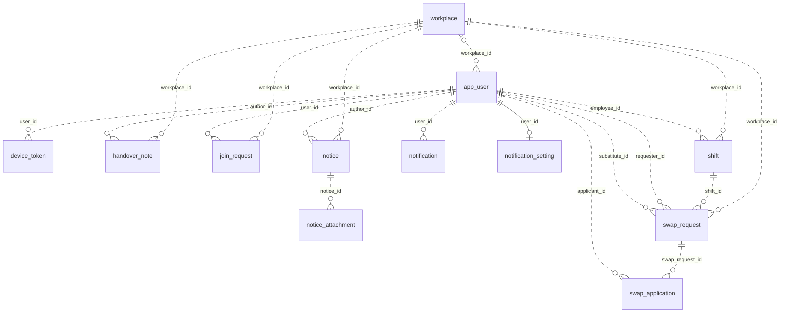

# 데이터 모델 — PTManager

[문서 안내](../README.md#관련-문서)

## 기준과 범위

컬럼·열거형 원본은 [Flyway SQL](https://github.com/parttime-manager/backend/tree/main/src/main/resources/db/migration)(V1~V5), [도메인 모델](https://github.com/parttime-manager/backend/tree/main/src/main/kotlin/com/ptmanager/backend/domain), [운영 설정](https://github.com/parttime-manager/backend/blob/main/src/main/resources/application-prod.yml)(PostgreSQL·Flyway `ddl-auto=none`, 로컬/테스트는 H2 `create-drop`)이다. JPA는 `Long` ID를 저장하고 타임스탬프는 `TIMESTAMPTZ`(API는 UTC)를 쓴다.

## 관계도

Flyway FK 기준이다(`notification_setting`만 PK 겸 FK 식별 관계 `--`, 나머지는 비식별 `..`).

## 데이터 흐름과 저장 의미

- **매장·근무:** `app_user.workplace_id`(NULL은 미소속)로 1인 1매장을 표현하고 `join_request` 승인 시 설정한다. `shift`는 편성·출퇴근·근태·발행 여부(V5 DB 기본값 `true`, 신규 API 편성 `false`; 노출은 [구현 차이](../01-func/01-requirements.md#현재-구현과의-차이))를 담는다.
- **대타·인건비:** `shift` → `swap_request` → `swap_application`으로 분리하며 승인 시 `shift.employee_id`·`swap_request.substitute_id`를 갱신하고 `requester_id`를 보존한다. 인건비는 집계 테이블 없이 근무 기록과 현재 `app_user.hourly_wage`로 계산한다([계산 기준](../01-func/01-requirements.md#근무와-인건비)).
- **공지·알림·QR:** 공지 미확인은 `last_read_notice_at`로 판별한다. 알림은 `notification`(인박스, FK 없는 `target_type`·`target_id`), `device_token`, `notification_setting`으로 나누며([알림 기준](../01-func/01-requirements.md#공지와-알림)), QR은 DB 저장 없이 서명과 서버 메모리 발급 시각으로 검증한다([QR 기준](../01-func/01-requirements.md#qr-출퇴근)).

## 무결성과 삭제 경계

| DB 제약 | 의미 |
| --- | --- |
| `workplace.invite_code`, `app_user.email`, `device_token.token` UNIQUE | 초대코드·이메일·기기 토큰 중복 방지 |
| `notification_setting.user_id` PK 겸 FK | 사용자별 설정 최대 1행 |
| `swap_application(swap_request_id, applicant_id)` UNIQUE / 부분 UNIQUE `uq_open_swap` | 중복 지원 방지 / 근무당 `PENDING` 대타 요청 최대 1건 |
| `swap_request.shift_id` `ON DELETE RESTRICT` | 대타 요청이 남아 있으면 근무 삭제 제한(서비스는 `PENDING`만 거부하고 완료된 이력은 선삭제 후 근무 삭제) |
| 지원→대타 요청, 첨부→공지 `ON DELETE CASCADE` | 부모 삭제 시 자식 행 삭제(공지 삭제 시 첨부 행만 지우고 S3 객체는 유지) |

인덱스는 Flyway SQL에서 관리하며 H2 테스트는 PostgreSQL 부분 UNIQUE·FK 검증을 대체하지 않는다. 상태 전이·충돌 검사는 [업무 규칙](../01-func/01-requirements.md#업무-규칙)을 따르며, 스키마 변경 시 새 Flyway SQL과 도메인 매핑에 반영한다.

## 관련 문서

- [요구사항](../01-func/01-requirements.md) · [배포 가이드](../05-ops/01-deploy.md)
