<h1 align="center">PTManager</h1>

  <b>소규모 매장의 근무 관리를 단톡방과 종이 근무표에서 앱 하나로 옮깁니다</b> 
  대타·근태·스케줄을 직원 앱 · 사장 앱이 공유하는 풀스택 팀 프로젝트

  
  
  
  

  <a href="https://github.com/parttime-manager/backend">Backend</a> /
  <a href="https://github.com/parttime-manager/android-app">Android</a>

---

## 핵심 기능

  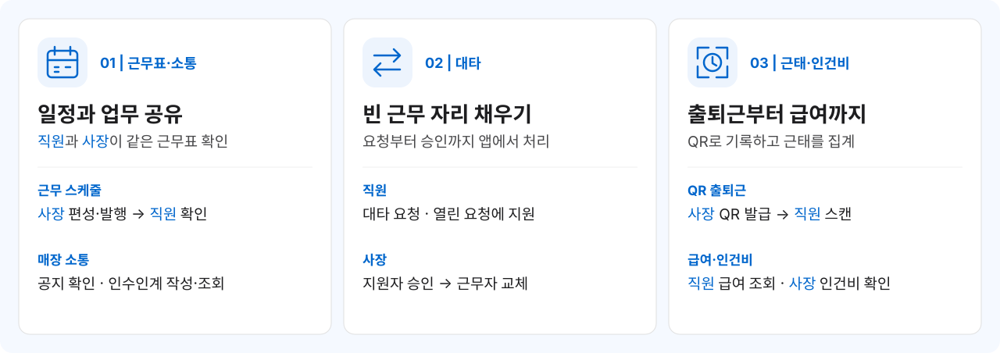

## 시스템 아키텍처

  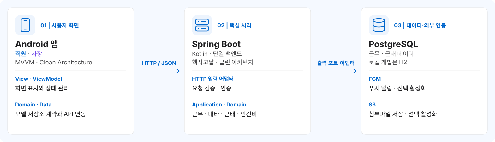

두 앱은 하나의 REST API와 데이터를 공유합니다. 서버가 직원·사장 역할과 매장 소속을 검사하고, 직원·사장 앱은 `android-app/` 저장소의 `employee/`·`employer/` 모듈로 관리하며 공통 소스는 `common/`에 둡니다. FCM·S3는 설정으로 활성화하며, 기본 로컬 실행에서는 스텁을 사용합니다.

백엔드는 헥사고날·클린 아키텍처의 유스케이스·출력 포트·어댑터로, Android는 MVVM·클린 아키텍처의 View·ViewModel·도메인·데이터 구현으로 분리합니다. JPA 매핑과 일부 기존 화면 렌더링은 유지합니다. 정확한 의존성 방향과 검사 범위는 [아키텍처 설계](../plan.md#아키텍처)를 참고하세요.

## 앱 화면

### 직원용 앱

| 홈 | 스케줄 | 소통 | 통계 | 내 정보 |
| --- | --- | --- | --- | --- |
| 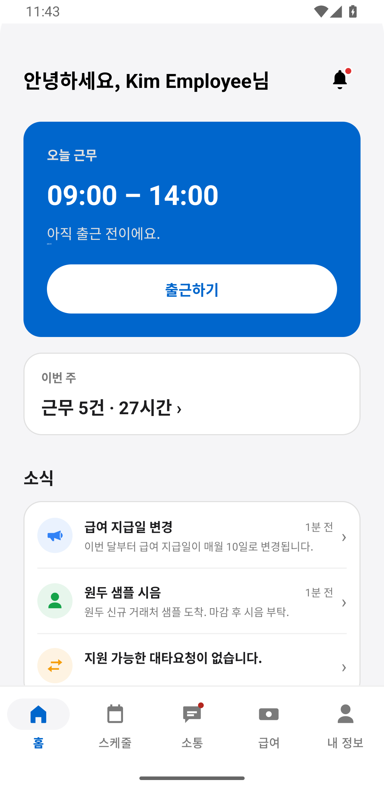 | 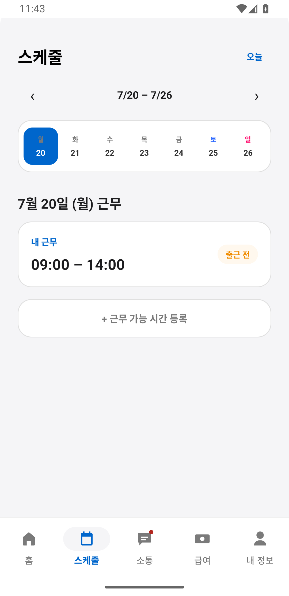 | 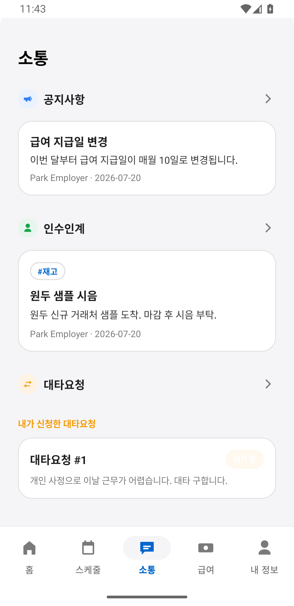 | 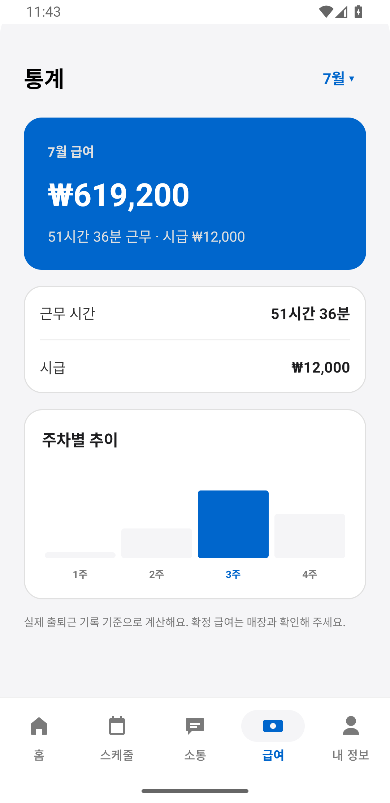 | 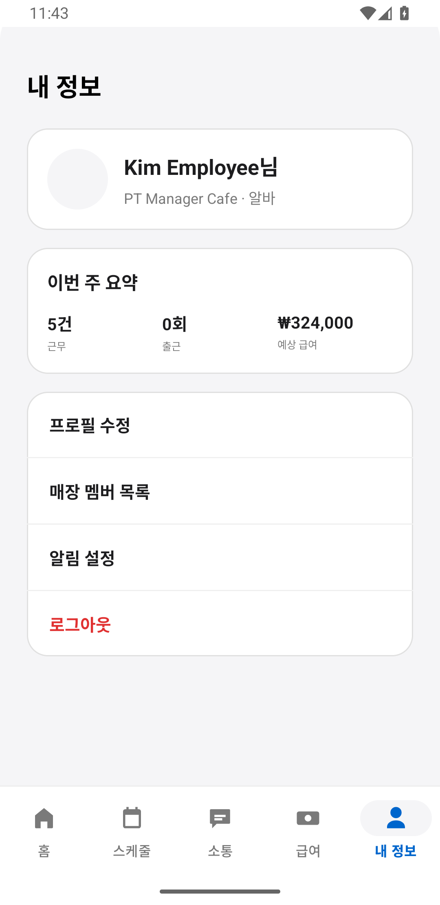 |

### 사장용 앱

| 홈 | 스케줄 | 승인 | 통계 | 내 정보 |
| --- | --- | --- | --- | --- |
| 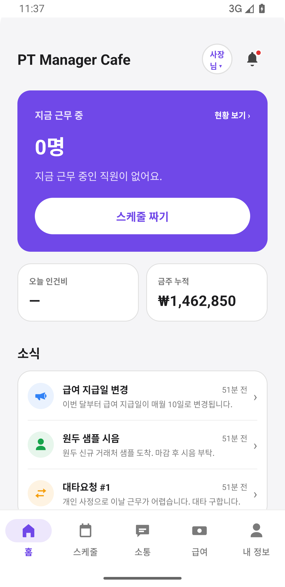 | 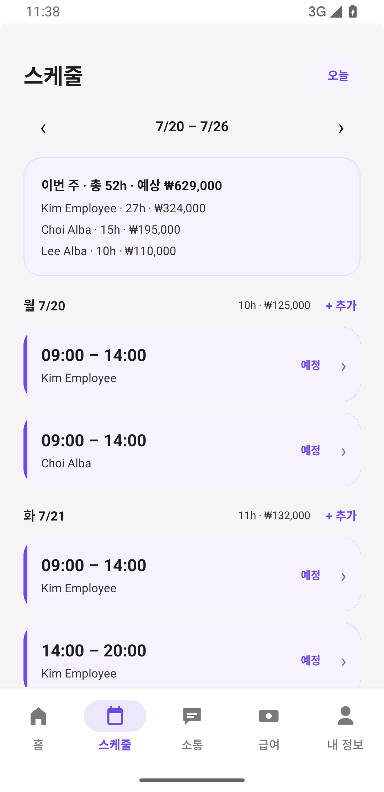 | 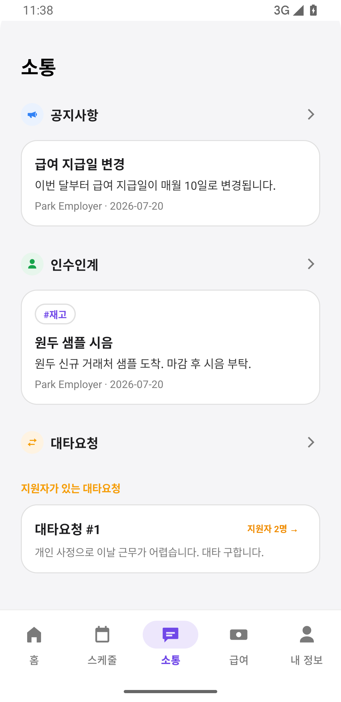 | 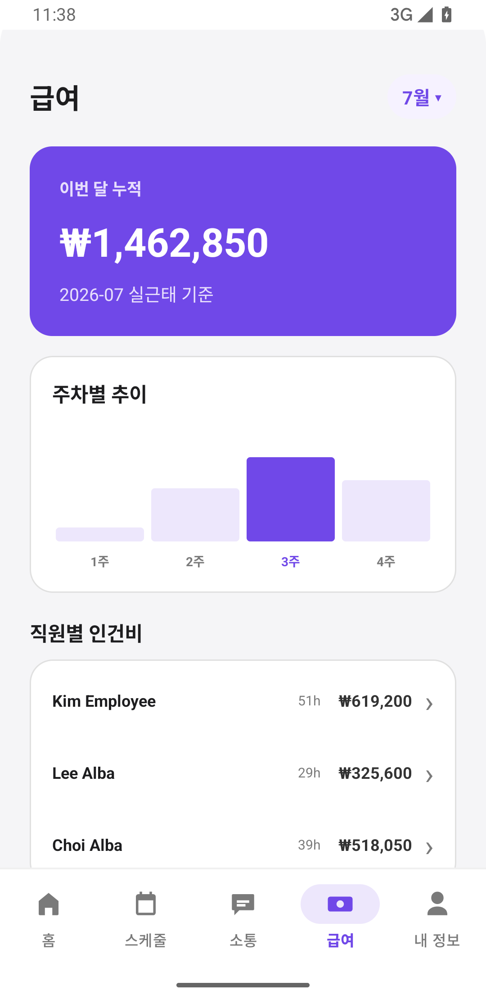 | 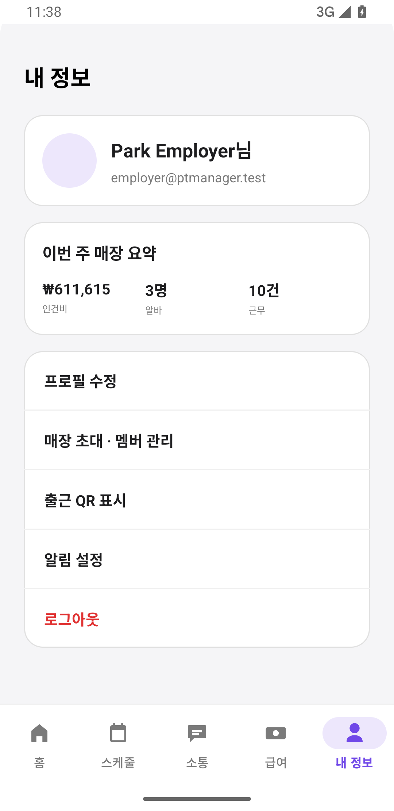 |

## 팀 구성

<table>
  <tr><td align="center"></td><td><b>정상겸</b> 팀장 · 풀스택</td><td>양쪽 앱 화면/API 연동 전반</td></tr>
  <tr><td align="center"></td><td><b>이동건</b> 풀스택 · 인프라</td><td>백엔드 코어 (인증·RBAC·REST API) · CI/CD</td></tr>
  <tr><td align="center"></td><td><b>김병수</b> 백엔드 · 문서 작성</td><td>회전형 QR · 공지 첨부파일</td></tr>
  <tr><td align="center"></td><td><b>정윤아</b> 프론트엔드</td><td>직원용 앱 - 화면 디자인 · 인수인계 노트</td></tr>
  <tr><td align="center"></td><td><b>김채은</b> 프론트엔드</td><td>사장용 앱 - 화면 디자인 · 인수인계 노트</td></tr>
</table>
