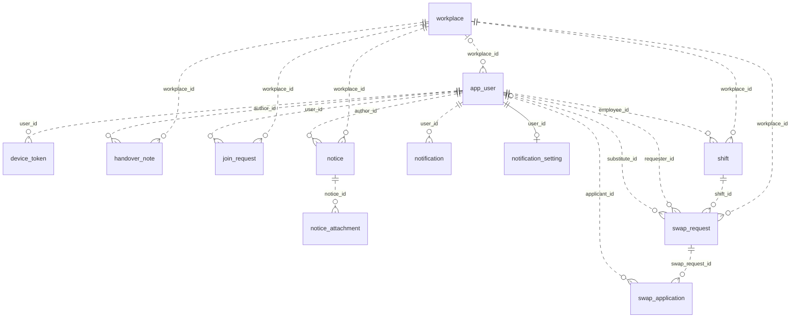

# PTManager 데이터 모델

[요구사항](../spec.md) · [구현 계획](../plan.md) · [API 계약](contracts.md)

## 기준과 범위

이 문서는 데이터 관계, 저장하는 값의 의미, 무결성 규칙을 설명한다. 컬럼 타입·기본값·열거형 전체 목록은 다음 원본을 확인한다.

- [Flyway SQL](https://github.com/parttime-manager/backend/tree/main/src/main/resources/db/migration): 운영 스키마의 기준. V1 초기 스키마와 V2~V5 변경분을 포함한다.
- [도메인 모델](https://github.com/parttime-manager/backend/tree/main/src/main/kotlin/com/ptmanager/backend/domain): Kotlin 매핑과 열거형.
- [운영 설정](https://github.com/parttime-manager/backend/blob/main/src/main/resources/application-prod.yml): PostgreSQL·Flyway를 사용하며 `ddl-auto=none`이다. 로컬/테스트는 H2의 `create-drop`을 사용하므로 운영 제약은 SQL에서 확인한다.

JPA는 연관 객체 대신 `Long` ID를 저장한다. 아래 관계도는 Flyway에 선언된 FK 기준이며, 운영 DB를 직접 조회한 결과가 아니다. 타임스탬프는 PostgreSQL `TIMESTAMPTZ`로 저장하고 API는 UTC로 전달한다.

## 관계도

Flyway SQL에 선언된 FK 관계를 나타낸다. `||`는 1개, `o|` 또는 `|o`는 0~1개, `o{`는 0개 이상이다. PK가 곧 FK인 `notification_setting`만 식별 관계(`--`)이고 나머지는 비식별 관계(`..`)다.

## 테이블 역할

| 테이블 | 역할 | 비고 |
| --- | --- | --- |
| `workplace` | 매장 | `invite_code` UNIQUE — 직원 가입 신청 키 |
| `app_user` | 사용자 (직원·사장 공통) | 1인 1매장(`workplace_id` NULL 허용), `hourly_wage`, `last_read_notice_at` |
| `notification_setting` | 사용자별 알림 수신 설정 | `user_id` PK 겸 FK (1:1) |
| `device_token` | FCM 토큰 | 멀티 디바이스, `token` UNIQUE |
| `shift` | 근무 | `attendance_status`, `checked_in_at`, `checked_out_at`(V2), `published`(V5) |
| `swap_request` | 대타 요청 | `requester_id`는 이력 보존, `substitute_id`는 승인 시 채워짐 |
| `swap_application` | 대타 지원 | `UNIQUE(swap_request_id, applicant_id)` — 중복 지원 차단 |
| `join_request` | 매장 가입 신청 | 사장 승인 시 `app_user.workplace_id` 설정 |
| `notice` | 공지 | 읽음은 `app_user.last_read_notice_at`로만 판정 |
| `notice_attachment` | 공지 첨부 | 공지 삭제 시 `ON DELETE CASCADE` |
| `handover_note` | 인수인계 (V3·V4) | `category` = `STOCK`/`DEVICE`/`CUSTOMER` |
| `notification` | 알림 인박스 | `target_type`/`target_id`로 딥링크 |

## 데이터 흐름과 저장 의미

- **매장 소속:** `app_user.workplace_id` 하나로 1인 1매장을 표현하며 NULL은 미소속이다. 초대코드로 `join_request`를 만들고 승인 시 소속을 설정한다. `app_user`라는 이름은 예약어 `user`와의 충돌을 피한다.
- **근무와 발행:** `shift` 한 행에 편성 시간·출퇴근 기록·근태·발행 여부를 저장한다. V5의 DB 기본값은 기존 근무 보존을 위해 `true`지만 API의 신규 편성은 `false`다. 직원 목록은 초안을 제외하지만 상세·출퇴근·급여는 발행 여부를 검사하지 않는다. 노출 범위는 [현재 근무 계약](contracts.md#조회편성삭제의-현재-제약)을 따른다.
- **대타 이력:** `shift` → `swap_request` → `swap_application`으로 대상 근무·요청·지원자를 분리한다. 승인 시 `shift.employee_id`와 `swap_request.substitute_id`를 바꾸고 `requester_id`는 원 요청자로 보존한다.
- **인건비:** 집계 테이블이나 과거 시급 스냅샷 없이 근무 기록과 현재 `app_user.hourly_wage`로 조회 시 계산한다. 시급 변경은 과거 기간의 조회 결과에도 영향을 준다. 시간 선택과 제외 조건은 [근무·근태·인건비 계약](contracts.md#근무근태인건비)을 따른다.
- **공지 읽음:** 사용자별 `last_read_notice_at`와 최신 공지 작성 시각을 비교한다. 공지별 열람자 이력은 저장하지 않는다. 공지 레드 닷과 알림 인박스의 `is_read`는 별개다.
- **알림:** `notification`은 인박스, `device_token`은 여러 기기의 푸시 주소, `notification_setting`은 푸시 수신 설정이다. `target_type`·`target_id`는 FK 없는 딥링크 정보다. 적재·발송 조건은 [알림 계약](contracts.md#알림-적재와-푸시)을 따른다.
- **QR:** 토큰을 DB에 저장하지 않는다. 서명으로 검증하고 매장별 최신 발급 시각만 서버 메모리에 보관한다. 재시작·여러 인스턴스의 영향은 [QR 계약](contracts.md#qr-출퇴근)에 둔다.

## 무결성과 삭제 경계

### DB 제약

| DB 제약 | 의미 |
| --- | --- |
| `workplace.invite_code`, `app_user.email`, `device_token.token` UNIQUE | 초대코드·로그인 이메일·기기 토큰 중복 방지 |
| `notification_setting.user_id` PK 겸 FK | 사용자별 설정 최대 1행 |
| `swap_application(swap_request_id, applicant_id)` UNIQUE | 동일 요청 중복 지원 방지 |
| 부분 UNIQUE `uq_open_swap` | 근무당 `PENDING` 대타 요청 최대 1건 |
| `swap_request.shift_id`의 `ON DELETE RESTRICT` | 참조하는 대타 요청이 남아 있으면 근무 삭제 제한 |
| 지원→대타 요청, 첨부→공지의 `ON DELETE CASCADE` | 부모 삭제 시 해당 자식 행 삭제 |

서비스의 근무 삭제는 대기 대타 요청이 있으면 거부하고, 처리된 요청과 지원 이력을 먼저 제거한 뒤 근무를 삭제한다. 따라서 `ON DELETE RESTRICT`가 처리된 대타 이력을 영구 보존한다는 의미는 아니다. 공지 삭제도 첨부 DB 행을 먼저 제거하며 S3 객체는 삭제하지 않는다. 첨부 업로드 후 공지 저장 전에는 파일 URL만 반환하고 DB 행은 만들지 않는다.

근무 목록·열린 대타·미확인 알림·최신 공지·인수인계 조회용 인덱스는 Flyway SQL에서 관리한다. H2 실행 결과를 PostgreSQL의 부분 UNIQUE·FK 검증 결과로 간주하지 않는다.

### 서비스 검증

DB 제약 외에 서비스에서 다음 규칙을 검사한다.

- 요청자는 본인 근무만 대타를 요청할 수 있고 자기 요청에는 지원할 수 없다.
- 근무 생성·수정의 중복 검사는 같은 날짜의 일반 근무끼리만 수행하며 야간 교대는 제외한다. 아래 대타 검사와 범위가 다르다.
- 지원·승인 시 근무 시간 겹침을 검사하며 야간 교대를 익일로 보정한다. 지원 단계에서는 다른 요청의 대기 중 지원도 고려한다. 현재 겹침 검사는 같은 근무일의 기록을 비교한다.
- 승인은 `PENDING` 조건부 갱신과 단일 트랜잭션으로 처리한다. 영향 행이 0이면 롤백하며, 선택 지원만 승인하고 나머지는 거절한다.
- 매장 접근 권한과 역할은 서버에서 검사한다. FK만으로 사용자·근무·요청이 모두 같은 매장인지 보장되지는 않는다.

## 변경할 때

스키마 변경은 새 Flyway SQL과 도메인 매핑에 반영하고 PostgreSQL 마이그레이션 검사로 확인한다. 이미 적용한 SQL은 수정하지 않는다. 이 문서는 관계·저장 의미·무결성 경계가 바뀔 때 갱신하고, API에서 보이는 동작 변경은 `contracts.md`와 관련 앱에 함께 반영한다.
