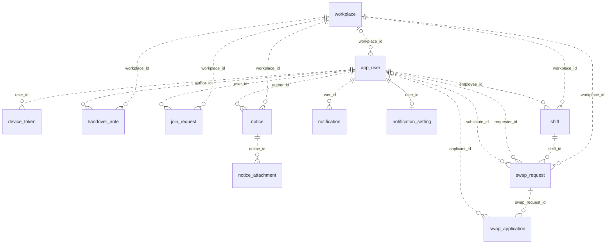

# 데이터 모델 — PTManager

[문서 안내](../README.md#관련-문서)

## 기준과 범위

이 문서는 데이터 관계, 저장하는 값의 의미, 무결성 규칙을 설명한다. 컬럼 타입·기본값·열거형 전체 목록은 다음 원본을 확인한다.

- [Flyway SQL](https://github.com/parttime-manager/backend/tree/main/src/main/resources/db/migration): 운영 스키마의 기준. V1 초기 스키마와 V2~V5 변경분을 포함한다.
- [도메인 모델](https://github.com/parttime-manager/backend/tree/main/src/main/kotlin/com/ptmanager/backend/domain): Kotlin 매핑과 열거형.
- [운영 설정](https://github.com/parttime-manager/backend/blob/main/src/main/resources/application-prod.yml): PostgreSQL·Flyway를 사용하며 `ddl-auto=none`이다. 로컬/테스트는 H2의 `create-drop`을 사용하므로 운영 제약은 SQL에서 확인한다.

JPA는 연관 객체 대신 `Long` ID를 저장한다. 아래 관계도는 Flyway에 선언된 FK 기준이며, 운영 DB를 직접 조회한 결과가 아니다. 타임스탬프는 PostgreSQL `TIMESTAMPTZ`로 저장하고 API는 UTC로 전달한다.

## 관계도

Flyway SQL에 선언된 FK 관계를 나타낸다. `||`는 1개, `o|` 또는 `|o`는 0~1개, `o{`는 0개 이상이다. PK가 곧 FK인 `notification_setting`만 식별 관계(`--`)이고 나머지는 비식별 관계(`..`)다.

## 데이터 흐름과 저장 의미

- **매장 소속:** `app_user.workplace_id` 하나로 1인 1매장을 표현하며 NULL은 미소속이다. 초대코드로 `join_request`를 만들고 승인 시 소속을 설정한다. `app_user`라는 이름은 예약어 `user`와의 충돌을 피한다.
- **근무와 발행:** `shift` 한 행에 편성 시간·출퇴근 기록·근태·발행 여부를 저장한다. V5의 DB 기본값은 기존 근무 보존을 위해 `true`지만 API의 신규 편성은 `false`다. 발행 여부에 따른 노출 범위는 [현재 근무 기준](../spec.md#현재-구현과의-차이)을 따른다.
- **대타 이력:** `shift` → `swap_request` → `swap_application`으로 대상 근무·요청·지원자를 분리한다. 승인 시 `shift.employee_id`와 `swap_request.substitute_id`를 바꾸고 `requester_id`는 원 요청자로 보존한다.
- **인건비:** 집계 테이블이나 과거 시급 스냅샷 없이 근무 기록과 현재 `app_user.hourly_wage`로 조회 시 계산한다. 시급 변경은 과거 기간의 조회 결과에도 영향을 준다. 시간 선택과 제외 조건은 [근무·근태·인건비 기준](../spec.md#근무와-인건비)을 따른다.
- **공지 읽음:** 사용자별 `last_read_notice_at`와 최신 공지 작성 시각을 비교한다. 공지별 열람자 이력은 저장하지 않는다. 공지 레드 닷과 알림 인박스의 `is_read`는 별개다.
- **알림:** `notification`은 인박스, `device_token`은 여러 기기의 푸시 주소, `notification_setting`은 푸시 수신 설정이다. `target_type`·`target_id`는 FK 없는 딥링크 정보다. 적재·발송 조건은 [알림 기준](../spec.md#공지와-알림)을 따른다.
- **QR:** 토큰을 DB에 저장하지 않는다. 서명으로 검증하고 매장별 최신 발급 시각만 서버 메모리에 보관한다. 재시작·여러 인스턴스의 영향은 [QR 기준](../spec.md#qr-출퇴근)에 둔다.

## 무결성과 삭제 경계

### DB 제약

| DB 제약 | 의미 |
| --- | --- |
| `workplace.invite_code`, `app_user.email`, `device_token.token` UNIQUE | 초대코드·로그인 이메일·기기 토큰 중복 방지 |
| `notification_setting.user_id` PK 겸 FK | 사용자별 설정 최대 1행 |
| `swap_application(swap_request_id, applicant_id)` UNIQUE | 동일 요청 중복 지원 방지 |
| 부분 UNIQUE `uq_open_swap` | 근무당 `PENDING` 대타 요청 최대 1건 |
| `swap_request.shift_id`의 `ON DELETE RESTRICT` | 참조하는 대타 요청이 남아 있으면 근무 삭제 제한 |
| 지원→대타 요청, 첨부→공지의 `ON DELETE CASCADE` | 부모 삭제 시 해당 자식 행 삭제 |

서비스의 근무 삭제는 대기 대타 요청이 있으면 거부하고, 처리된 요청과 지원 이력을 먼저 제거한 뒤 근무를 삭제한다. 따라서 `ON DELETE RESTRICT`가 처리된 대타 이력을 영구 보존한다는 의미는 아니다. 공지 삭제도 첨부 DB 행을 먼저 제거하며 S3 객체는 삭제하지 않는다. 첨부 업로드 후 공지 저장 전에는 파일 URL만 반환하고 DB 행은 만들지 않는다.

근무 목록·열린 대타·미확인 알림·최신 공지·인수인계 조회용 인덱스는 Flyway SQL에서 관리한다. H2 실행 결과를 PostgreSQL의 부분 UNIQUE·FK 검증 결과로 간주하지 않는다.

역할·매장 일치·시간 충돌·상태 전이는 [업무 규칙](../spec.md#업무-규칙)에 따라 서비스에서 검사한다.

## 변경할 때

스키마 변경은 새 Flyway SQL과 도메인 매핑에 반영하고 PostgreSQL 마이그레이션 검사로 확인한다. 이미 적용한 SQL은 수정하지 않는다. 이 문서는 관계·저장 의미·무결성 경계가 바뀔 때 갱신하고, API에서 보이는 동작 변경은 요구사항와 관련 앱에 함께 반영한다.

## 관련 문서

- [요구사항](../spec.md): 제품 범위·완료 기준
- [배포 가이드](deploy.md): 운영 설정·배포·점검
